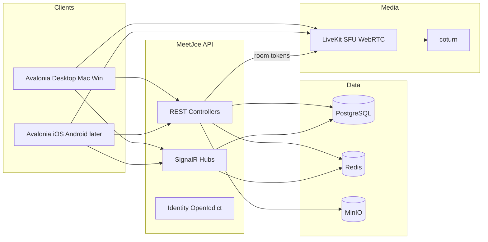

# MeetJoe Architecture

## Locked technical decisions

| Concern | Decision |
| --- | --- |
| Client | Avalonia 11.x + .NET 9, MVVM (`CommunityToolkit.Mvvm`) |
| UI sharing | Shared `MeetJoe.App` + thin hosts (`Desktop`, later `iOS` / `Android`) |
| Backend | ASP.NET Core modular monolith (vertical slices), REST + SignalR |
| Auth | ASP.NET Core Identity + OpenIddict (OIDC/JWT); multi-tenant orgs from day one |
| Realtime control | SignalR: chat, presence, notifications, meeting metadata |
| Media data plane | **LiveKit** SFU (**WebRTC**); coturn STUN/TURN when leaving localhost |
| Data | PostgreSQL (EF Core), Redis, MinIO (S3-compatible; Chainguard image locally) |
| Local infra | Docker Compose (`deploy/`); Postgres host port **5433**, API **5080** |
| Packaging / updates | Velopack installers + semver auto-update feed on the API (`/updates/desktop/{rid}`) |
| Early production hosting | Single small AWS EC2 (target ≤ $20/month total) |

### WebRTC vs EasyRTC

- **WebRTC** is the standard for real-time A/V (used by Teams, Meet, Zoom, Discord).
- **EasyRTC** is an older Node.js wrapper *on top of* WebRTC — not a protocol alternative, poor .NET fit, weak for large meetings.
- MeetJoe uses **WebRTC via LiveKit**, not EasyRTC.
- Confirmed: video conference, screen share, and related media all go through LiveKit (WebRTC).

## Lean AWS deployment (early stage, 1–10 people)

**Target**: total AWS bill ≤ **$20/month** while supporting chat, real-time notifications, presence, 1:1 and small-group video calls, and screen share.

### Recommended starting instance
- **Type**: `t3.small` or `t3a.small` (2 vCPU, 2 GB RAM) — practical minimum for LiveKit + the rest of the stack.
- **Layout**: single instance running everything via Docker Compose:
  - ASP.NET Core API + SignalR
  - PostgreSQL
  - Redis
  - MinIO
  - LiveKit + coturn
- Avoid managed services (RDS, ElastiCache, ALB, NAT Gateway) at this stage — they push the bill over $20 quickly.

### What this setup comfortably supports
| Feature | Supported on small instance | Notes |
|---------|-----------------------------|-------|
| Real-time chat & messages | Yes | SignalR is lightweight |
| Notifications & presence | Yes | Negligible load |
| 1:1 video calls | Yes | Excellent |
| Small group video (2–5 people) | Yes | Adaptive bitrate recommended |
| Screen share | Yes | Usually lower bitrate than multiple cameras |
| Typing indicators, read receipts | Yes | Negligible |

**Limits to expect**:
- 6–10 people with several cameras on will feel constrained (higher CPU, possible quality drops).
- T-family instances are burstable; long continuous video meetings can exhaust CPU credits and cause temporary slowdowns.
- Prefer adaptive quality (360p/480p default) to stay smooth.

### Cost-control tips
- First 100 GB of AWS egress is free each month — covers a lot of small-team meeting traffic.
- Set a budget alert at ~$18.
- Optionally stop the instance outside business hours to reduce compute cost further.
- Variable cost of a 1-hour small meeting is typically a few cents to under $1 (bandwidth).

## System diagram



## Solution structure

```
MeetJoe/
  src/
    MeetJoe.App/                 # Shared Avalonia UI + ViewModels
    MeetJoe.Desktop/             # Mac/Windows host
    MeetJoe.iOS/                 # Future
    MeetJoe.Android/             # Future
    MeetJoe.Api/                 # ASP.NET Core host
    MeetJoe.Application/         # Use cases / handlers
    MeetJoe.Domain/              # Entities, domain rules
    MeetJoe.Infrastructure/      # EF, Redis, MinIO, LiveKit client, email
    MeetJoe.Contracts/           # DTOs / realtime event contracts
  tests/
    MeetJoe.Domain.Tests/
    MeetJoe.Api.Tests/
    MeetJoe.App.Tests/
  deploy/
    docker-compose.yml
    livekit.yaml
  docs/
    DESIGN.md
    ROADMAP.md
    ARCHITECTURE.md
```

## Domain model (core)

- `Organization`, `User`, `Membership`, `Role`
- `Conversation` (Direct | Group), `ConversationMember`
- `Workspace` (Team), `Channel` (Standard | Private | Shared), `ChannelMember`
- `Message` (chat or channel), `MessageReaction`, `Attachment`, `Thread`
- `Meeting`, `MeetingParticipant`, `MeetingRecording` (later)
- `Call`, `CallParticipant`
- `PresenceState`, `Notification`, `FileObject`

## Realtime contracts

| Hub / path | Responsibility |
| --- | --- |
| `ChatHub` | Send/edit/delete message, typing, read receipts, thread reply |
| `PresenceHub` | Set/get status, subscribe org roster |
| `NotificationHub` | Activity push |
| Meeting media | API issues LiveKit room JWT; client joins LiveKit; SignalR only for lobby / admit / raise-hand metadata |

## Scaling notes (Phase 8)

- SignalR: Redis backplane (or Azure SignalR if hosted on Azure)
- LiveKit: multi-node with Redis for room routing
- Sticky sessions required for SignalR unless using a managed proxy / WebSockets-only skip negotiation
- Move off the single small instance once team size or concurrent video usage grows beyond the $20 lean target.
